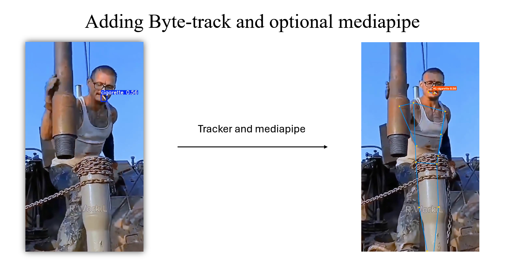
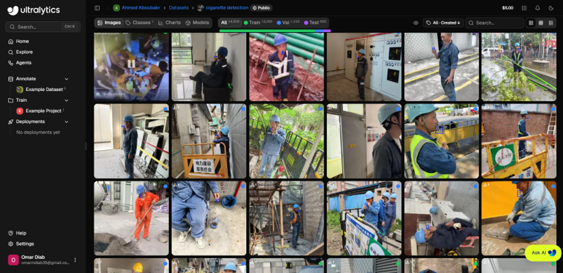

# Smoking Detection: AI & MLOps Project

Computer-vision proof of concept for detecting cigarettes in industrial CCTV footage: custom-trained **YOLO26s** + **ByteTrack** tracking + optional **MediaPipe Pose** gating.

Smoking near fuel or process equipment is a safety hazard on industrial sites, and manually reviewing CCTV footage doesn't scale. This flags cigarettes automatically so safety engineers can prioritize what to review.

|         | Prototype                              | Deployment                                       |
| ------- | -------------------------------------- | ------------------------------------------------ |
| Purpose | AI pipeline dev/experimentation        | Running the system as a service                  |
| Process | Single Flask process, model in-process | `Flask_UI` web app + `AI_Worker` FastAPI service |
| Run     | `python app.py`                        | `docker compose up --build`                      |

- [Prototype docs](Smoking_Detection_Prototype/README.md)
- [Deployment docs](Smoking_detection_Deployment/README.md)

## Architecture


#### Image/video → YOLO26s detects → ByteTrack tracks (video) → optional MediaPipe Pose filters to human-held detections.



## Why These Technologies

| Tech                                                           | Role                                                                                                                              |
| -------------------------------------------------------------- | --------------------------------------------------------------------------------------------------------------------------------- |
| **[YOLO26s](https://docs.ultralytics.com/models/yolo26/)**     | Cigarettes are tiny in CCTV footage (many boxes <70px) and easily hidden by hands/smoke. YOLO26's **STAL** (Small-Target-Aware Label Assignment) keeps small-object supervision during training.            |
| **[ByteTrack](https://github.com/FoundationVision/ByteTrack)** | Tracks cigarettes across frames so one isn't double-counted.                                                                      |
| **MediaPipe Pose**                                             | Optional "require human" gate — keeps detections near a tracked person's mouth/hands. `hand_landmarker.task` ships but is unused. |
| **Flask / FastAPI**                                            | Web UI + API (`Flask_UI`); `AI_Worker`'s internal inference API (Deployment only).                                                |
| **OpenCV**                                                     | Frame/video I/O, drawing, encode/decode.                                                                                          |
| **PyTorch & Ultralytics**                                      | Training/inference runtime; FP16 on CUDA.                                                                                         |
| **ffmpeg**                                                     | Re-encodes output to browser-playable `.mp4`.                                                                                     |
| **Docker Compose**                                             | Splits web UI and inference into separate services (Deployment only).                                                             |


_Ultralytics' official COCO benchmark — context for the YOLO26s pick._

## Model Training & Evaluation

Fine-tuned `yolo26s.pt` in the [training notebook](Yolo26s%20Training%20%28kaggle%29.ipynb), on Kaggle (2 GPUs).



|            |                                                                                                                                                           |
| ---------- | --------------------------------------------------------------------------------------------------------------------------------------------------------- |
| Dataset    | [cigarette detection](https://platform.ultralytics.com/ahmed-aboubakr/datasets/cigarette-detection1) — 14,309 images: 12,259 train / 1,152 val / 898 test |
| Resolution | 640×640 train, 1280×1280 inference                                                                                                                        |
| Epochs     | 60 max, early-stopped at **37**                                                                                                                           |
| Model      | ~9.5M params, 20.8 GFLOPs                                                                                                                                 |

## Repository Structure

```
.
├── Assets/
├── Smoking_Detection_Prototype/     # single-process Flask app
├── Smoking_detection_Deployment/    # Flask_UI + AI_Worker (Docker Compose)
├── Testing_Samples/                 # sample images/videos
├── Yolo26s Training (kaggle).ipynb
└── .gitignore
```

## Quick Start

```bash
# Prototype
cd Smoking_Detection_Prototype/Flask_UI && pip install -r requirements.txt && python app.py

# Deployment
cd Smoking_detection_Deployment && docker compose up --build
```
