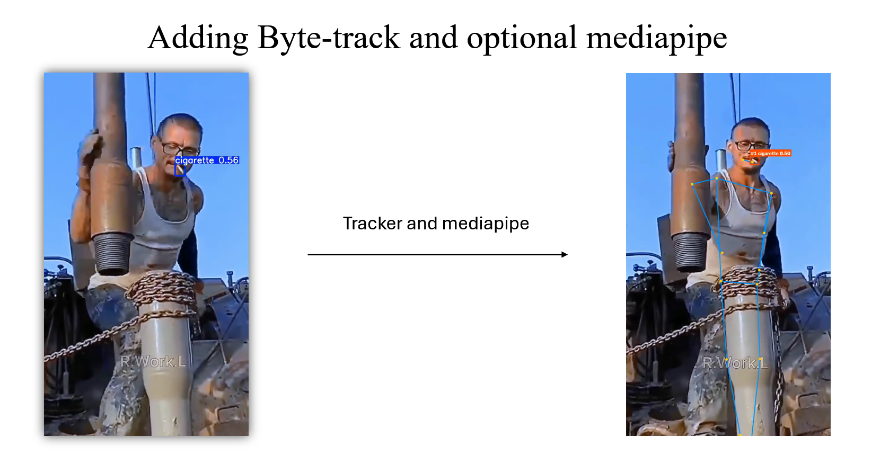

# Smoking Detection — Prototype

Single-process Flask app running the full pipeline in-process — the dev/experimentation variant. See the [root](../README.md) and [Deployment](../Smoking_detection_Deployment/README.md) docs.

## Pipeline

1. **Upload** — `app.py`'s `/api/detect`.
2. **Detect** — YOLO26s `predict()`/`track()`, `imgsz=1280`, `iou=0.5`.
3. **Track** (video) — ByteTrack + a custom `_stitch_track_ids()` pass for occlusion gaps.
4. **Pose gate** (optional) — `require_human` keeps only detections near a person's mouth/hand.
5. **Draw**, ffmpeg re-encode (video), save to `results/`.



## Model

|                   |                                                  |
| ----------------- | ------------------------------------------------ |
| Weights           | [`Model/weights/best.pt`](Model/weights/best.pt) |
| Train / infer res | 640×640 / **1280×1280**                          |
| Confidence        | 0.25 image, 0.1 video→ByteTrack                  |
| NMS IoU           | 0.5                                              |
| Classes           | 1 — `cigarette`                                  |

## ByteTrack & MediaPipe

Custom [`bytetrack_custom.yaml`](Flask_UI/model/trackers/bytetrack_custom.yaml): `track_high_thresh=0.3`, `track_low_thresh=0.1`, `new_track_thresh=0.3`, `track_buffer=150` (~6s), `match_thresh=0.9` — tuned for a small object that disappears behind fingers for a while.

MediaPipe **Pose only** (`pose_landmarker_lite.task`), toggled by the UI's "Only count cigarettes held by a person" checkbox. Pose replaced Hands (which failed on gloved hands); `hand_landmarker.task` ships but is unused.

## Dataset and Training

See the [root README](../README.md#model-training--evaluation) for the dataset, training setup, and metrics.

## Run It

```bash
cd Smoking_Detection_Prototype/Flask_UI
pip install -r requirements.txt
python app.py
```

Open http://localhost:5000. Weights included; `bin/ffmpeg.exe` isn't (falls back to `PATH`). 500MB upload limit.

## Outputs

- Image: `results/<uid>_result.<ext>` + JSON `{detections, count}`.
- Video: `results/<uid>_result.mp4` (+ `_web.mp4` if ffmpeg succeeds) + JSON `{total_frames, frames_with_smoking, total_detections, unique_smokers}`.
- `unique_smokers` = stitched ByteTrack track count.
